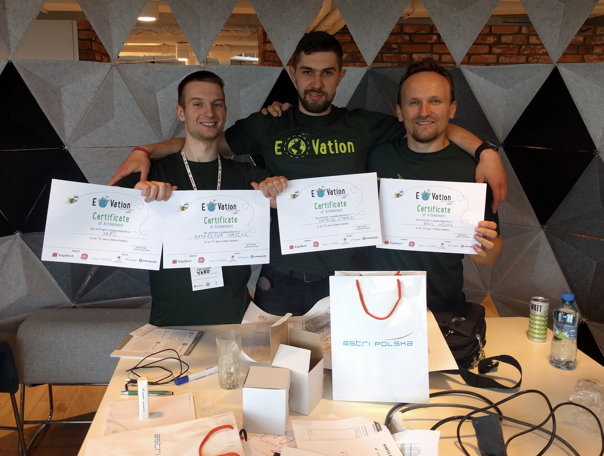
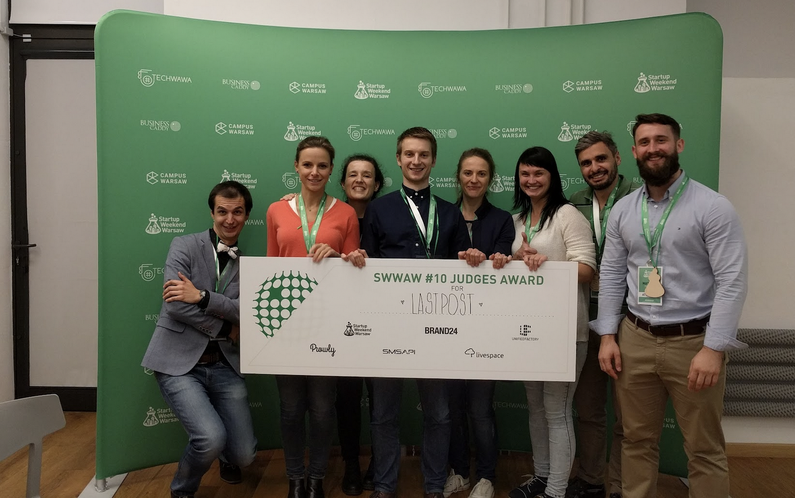
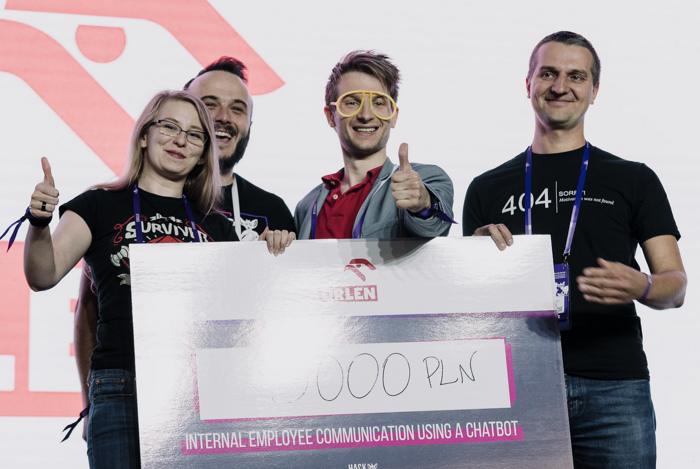
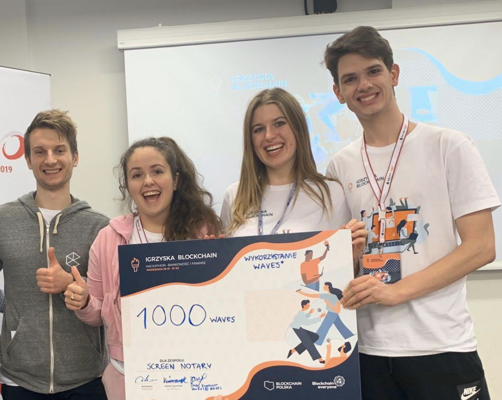
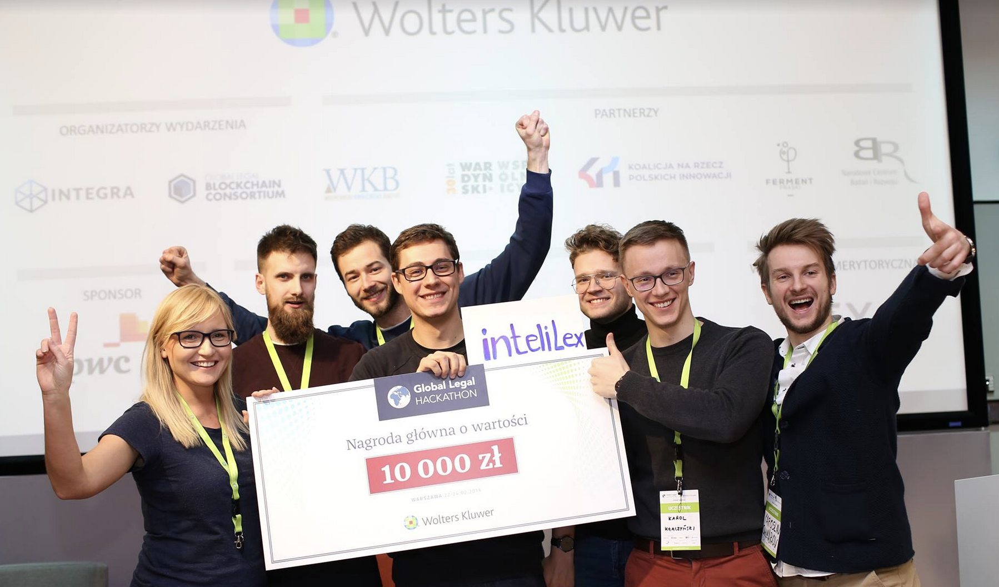
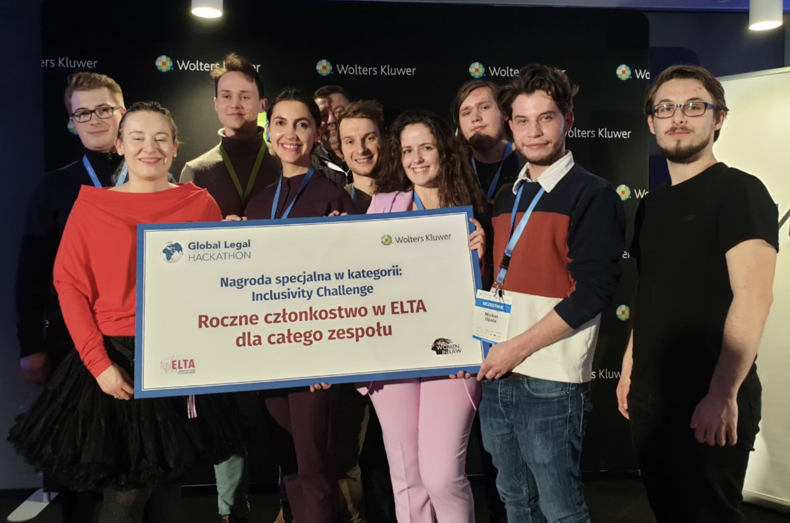
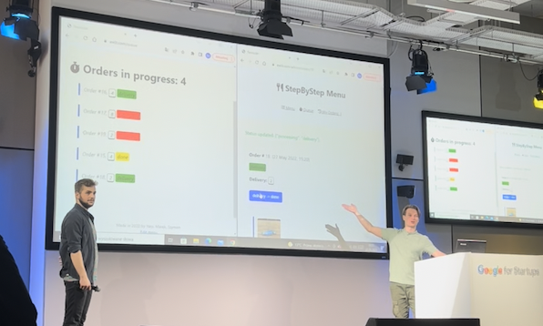
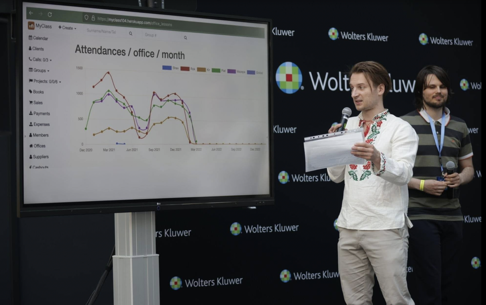
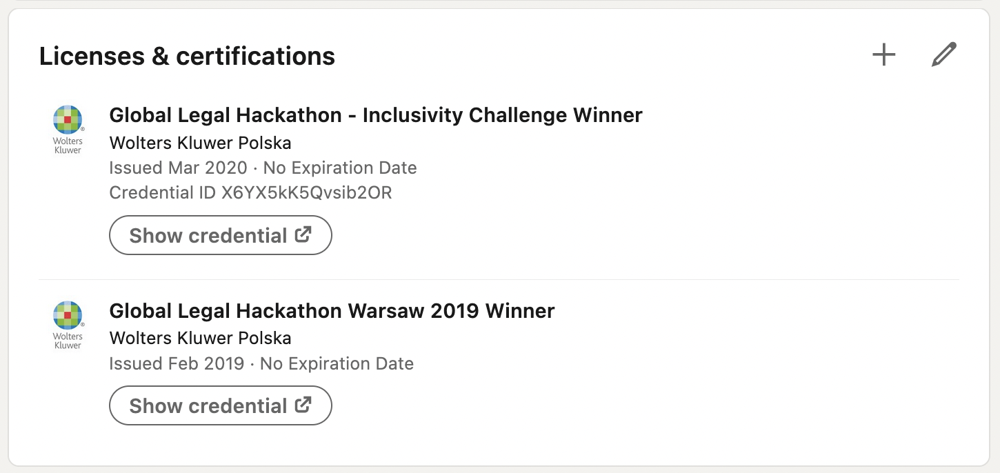

**I have a hobby: visiting hackathons and “startup weekends”.**

Over the last 5 years I’ve participated in ~15 events (and won ±7 of them)

**How hackathons/startup_weekends work:**

1️⃣ on Friday you gather a team, decide on an idea, start work. Each event usually has a “theme” (legaltech/medtech/fintech/fashion etc.)

2️⃣ on Saturday you work on the idea, get feedback from mentors

3️⃣ on Sunday you prepare the MVP, the presentation, and finally pitch the idea on stage; possibly win a prize!

… and on Monday you most likely never come back to that idea 😵

**Some project highlights that I’ve worked on:**

🏅 **sunorwind/gRoof, 2017** 

📜 Project summary: enter your home address to get calculations on savings & costs of installing solar/wind energy/green roof.

It was organized as part of Nasa Space Apps Challenge.

That was my first victory!

Prize - paid trip to visit 🛩️ AirBus in Toulouse, 🇫🇷.

With my great teammates - Emil, Kasia and Mateusz:

🏅 **LastPost*, 2017**

📜 Project summary: will/testament on the blockchain. 

Prize - $2500/8 people 🤪.

🥉**Donna* 2019**

“Hackyeah” - annual hackathon in Poland with 2500 participants.

The Prime Minister of 🇵🇱 came to visit and I took a picture with him!

Prize - $750/4 people.

📜 Project summary: Chatbot to answer FAQ for employees of an organization.

🥇**Screen Notary 2019**

📜 Project summary: store a webpage screenshot on blockchain, certifying that this is what it looked like at a moment in time (so that it can be used in legal proceedings). 

**Dream team**: Me, wife, sister, sisters BF 👨‍👩‍👧‍👦

🥇 **Intelilex 2019**

📜 Project summary: Microsoft Word autocomplete plugin. Biggest success, longest ride.

[Youtube video: intelilex](https://www.youtube.com/watch?v=moCZ-1iGBcs) (we paid ±$1000 for this video).

In spring 2022 we sold our company for a 4-digit $ number / 7 people 💰💰💰

🥈**Easygration 2020**

Hackathon organizaed by WoltersKluwer in the last days befor COVID lockdown in March 2020.

📜 Project summary: Turning immigration law 2 code and automating immigration process”.

[Youtube video: Easygration](https://www.youtube.com/watch?v=Eq9Q4SzPJAo)

🥉🍽️ **"StepByStep Menu", May 2022**

My first hackathon after COVID!

📜 Project summary: QR menu, ordering, payment, live queue (provide the McDonalds ordering experience to any restaurant).

[Github: source code](https://github.com/yshmarov/stepbystepmenu)

🥉⚖️ **“VeriCerti” June 2022**

📜 Project summary: bulk Linkedin certificate generator

[Github: source code](https://github.com/yshmarov/vericerti)

**Why do I keep participating???**

I think that visiting hackathons is a great way to 🤝 **get acquainted** with like-minded people, 👩‍💻**try to create something** over weekend, 💡 **validate ideas**, 🎤 **pitch practice**. 

🎉 It’s always a fun experience to live through!

If you’re interested in this kind of experience - Here’s a [**📅 calendar of startup weekends**](https://www.techstars.com/events#search_events=Startup) around the globe.

With love, Yaro 🐻