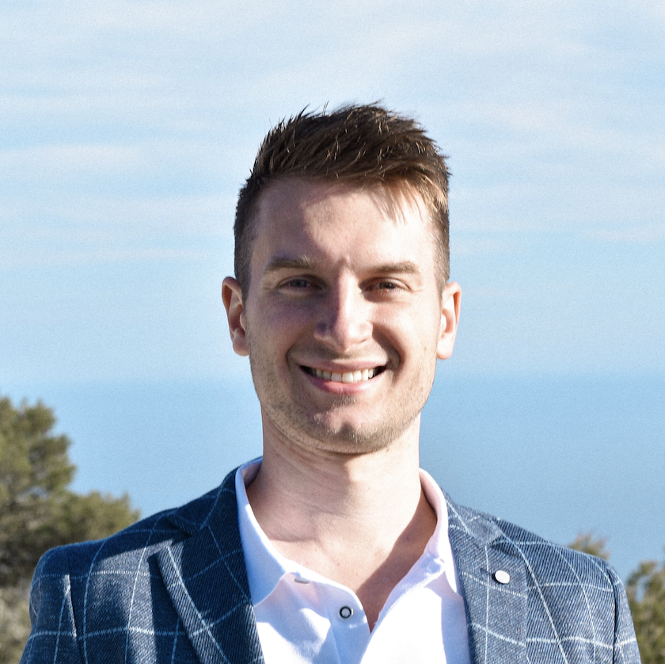
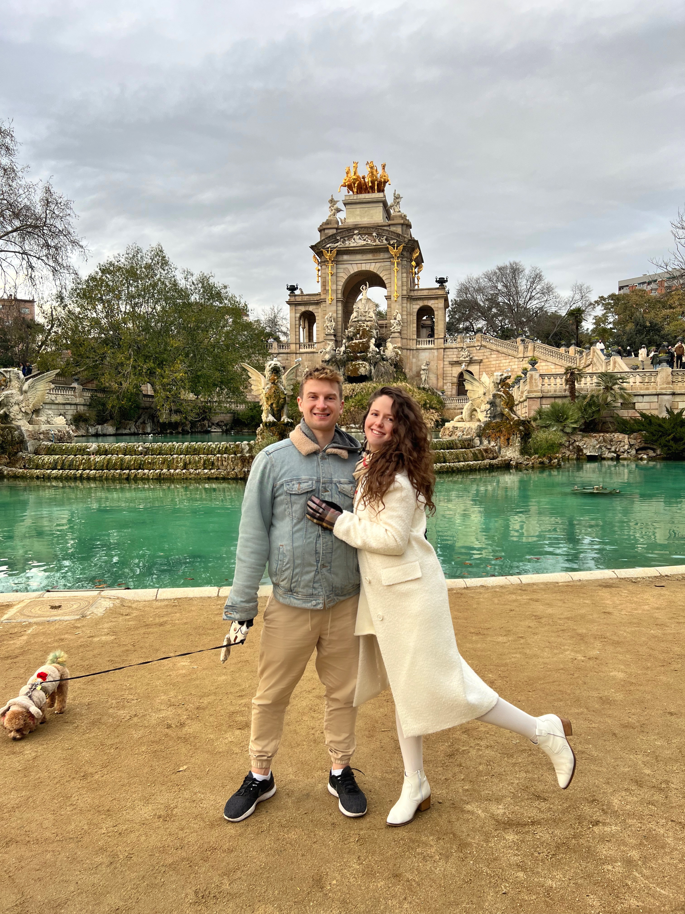
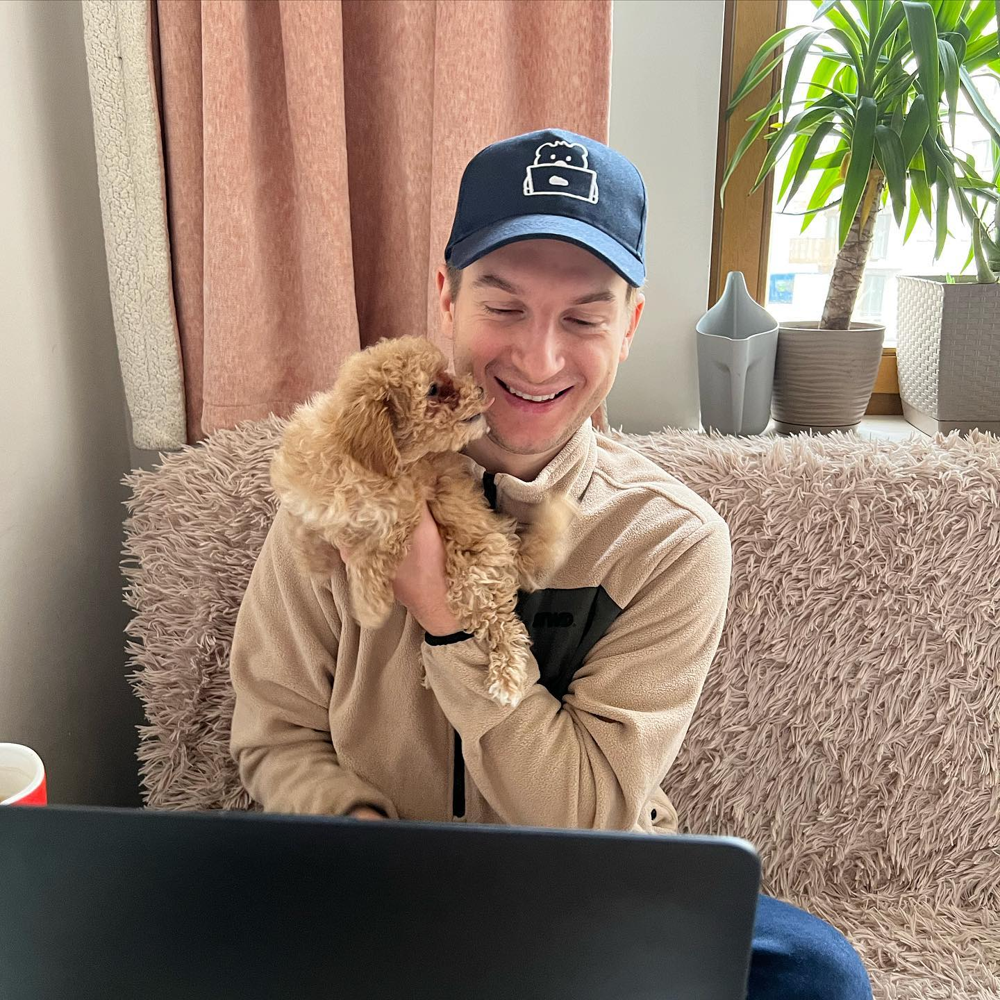

  
  
  

I'm Yaroslav, Yaro for short. I'm originally from Chernihiv, Ukraine 🇺🇦. I've lived in Warsaw, Poland for ten years, and these days I split my time between Warsaw, Cannes and Monaco with my wife, kid and [puppy](https://www.instagram.com/maltipoo_land/).

In my free time I write, windsurf 🏄‍♂️, hike with my dog 🐶 and work on my languages.

## Six languages

* 🇺🇦 Ukrainian
* 🇬🇧 English
* 🇩🇪 German
* 🇪🇸 Spanish
* 🇫🇷 French
* 🇵🇱 Polish

## Beliefs. Life, love, death

* Is life worth living, if you have nothing to die for? When I was a kid, I dreamt of living forever and thought that there's nothing more important than life. My life. Now, as a husband, parent and citizen of a country fighting for survival, I have grown up. I believe that freedom, love and family are more important than life. There are things worth dying for. That makes life worth living.
* Without knowing of death you wouldn't value the time you were given to live.
* Sacrificing freedom for "peace" is the path to slavery. That's why we fight. Stand with Ukraine.
* Ideas are worth nothing. Implementation is everything.
